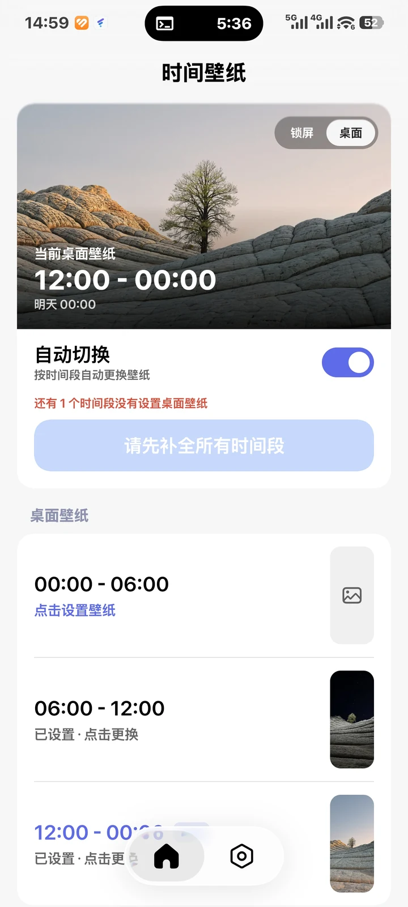

# 时间壁纸 (Time Wallpaper)

按时间段自动更换 Android 桌面 / 锁屏壁纸。完全本地运行，不上传任何图片。



## 功能

- **按时间切换**：默认 `00:00 / 06:00 / 12:00 / 18:00` 四个时间点，可自由增删改，最多 24 个（即最多 24 个时间段）。
- **桌面 / 锁屏分开设置**：默认关闭，锁屏跟随桌面；开启后主页可分别设置。
- **内置裁剪**：选择照片后按屏幕比例进入裁剪，支持双指缩放、拖动、90° 旋转，导出为屏幕分辨率（性能最好，切换只解码一次）。
- **多种来源**：系统照片选择器、文件选择器、最近使用过的壁纸（可删除）。
- **液态玻璃底栏**：基于 [Kyant0/AndroidLiquidGlass](https://github.com/Kyant0/AndroidLiquidGlass)（`io.github.kyant0:backdrop`）的默认参数，UI 组件来自 [Miuix](https://github.com/compose-miuix-ui/miuix)。
- **关于页**：复刻 [Nexio 课程表](https://github.com/HaoZai000/NexioSchedule) 的关于页布局，含 GitHub 仓库、更新日志、开源协议、检查更新与自动检查更新。
- **首次引导**：按厂商适配自启动入口（小米 / 华为 / 荣耀 / OPPO / vivo / 一加 / 魅族 / 三星 / 联想 / 乐视 / 华硕 / 努比亚 / 锤子），并引导忽略电池优化、授予精确闹钟权限。

## 后台策略（省电 + 不漏切）

- 只在每个时间点用 `AlarmManager.setExactAndAllowWhileIdle` 唤醒一次，没有常驻服务、没有轮询、没有 WakeLock。
- 每次闹钟触发后立刻续排下一个时间点；开机、应用更新、修改时间 / 时区后自动重排。
- **自愈**：每次解锁（`USER_PRESENT`）、打开应用、闹钟触发时都会核对当前时段是否已经应用，漏掉的切换会补上。
- 当前时段的壁纸缺失 / 文件被删 / 无法解码时，保持现有壁纸，不做半截切换。

## 构建

```bash
# JDK 17, Android SDK: platform 37.0, build-tools 36.0.0
./gradlew :app:assembleDebug
```

`gradle.properties` 中的 `android.aapt2FromMavenOverride` 是为了在 ARM64 Linux（PRoot / Termux 等）上运行官方 x86_64 aapt2 用的，普通 x86_64 开发机可以删掉这一行。

## 开源协议

GNU General Public License v3.0，见 [LICENSE](LICENSE)。
